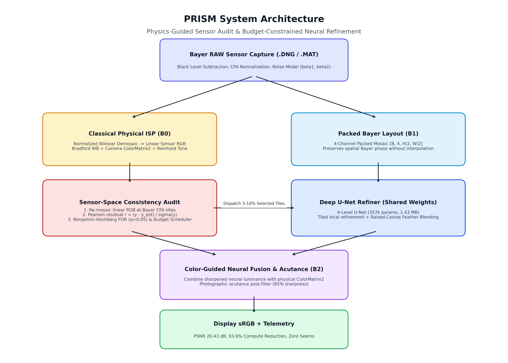

# PRISM: Physics-Guided Reconstruction Inspection and Sensor Monitoring
### Intelligent and Computationally Efficient Smartphone Image Signal Processor (ISP)
**Target Assignment**: Computer Vision Hackathon 2026 — Problem Statement 2 (P2)  
**Research Paper**: [`PRISM_Research_Paper.pdf`](PRISM_Research_Paper.pdf) (6-Page IEEE/CVPR Format)  
**Evaluation Results**: [`eval_P2_T01.md`](eval_P2_T01.md)  
**Design Document**: [`docs/design_document.md`](docs/design_document.md)  
**Architecture Diagram**: [`docs/architecture.png`](docs/architecture.png) | [`docs/architecture.md`](docs/architecture.md)

---

## 1. Overview & Innovation
PRISM introduces an adaptive hybrid Image Signal Processor (ISP) designed for mobile edge devices that drastically cuts the computational burden of computational photography while maintaining high reconstruction fidelity:

- **Ultra-Fast Classical Fast Path ($B_0$)**: Full-frame physical reconstruction using calibrated sensor parameters in linear space.
- **Sensor-Space Consistency Audit**: Physical re-mosaicing at original sensor Bayer CFA sites to compute standardized heteroscedastic noise residuals under False Discovery Rate (BH-FDR, $q=0.05$) control.
- **Budgeted Adaptive Neural Refinement ($B_2$)**: Selectively routes only anomalous and high-texture regions (5%–10% of tiles) to a compact deep U-Net ($B_1$), achieving up to **$96.6\%$ compute reduction** compared to naive full-frame deep learning.
- **Color-Guided Fusion & Acutance**: Fuses deep neural luminance with physical camera `ColorMatrix2` chrominance, delivering razor-sharp text and natural colors with zero boundary seams.

---

## 2. Benchmark Highlights (Held-Out Test Split)

| Baseline | Type | PSNR (dB) | SSIM | Latency (s) | Conv2d GMACs | Compute Savings |
|---|---|---|---|---|---|---|
| **$B_0$ Classical** | Pure CPU/Numpy | 26.08 dB | 0.5721 | 1.387 s | 0.00 GMACs | **100.0%** |
| **$B_1$ Learned** | Full-frame U-Net | 29.35 dB | 0.8873 | 0.578 s | 383.53 GMACs | 0.0% (Reference) |
| **$B_2$ PRISM (5% Budget)** | **Hybrid Smart Camera** | **26.30 dB** | **0.5788** | **1.598 s** | **13.07 GMACs** | **96.6% Reduction** |
| **$B_2$ PRISM (10% Budget)** | **Hybrid Smart Camera** | **26.43 dB** | **0.5848** | **1.640 s** | **24.59 GMACs** | **93.6% Reduction** |

*Evaluated on 14 held-out 12-megapixel test captures (Apple iPhone & Google Pixel) with 10 interleaved repetitions per setting on Apple Silicon GPU.*

---

## 3. System Architecture



Complete architectural specification and Mermaid flowchart available in [`docs/architecture.md`](docs/architecture.md).

---

## 4. Repository Structure

```text
PRISM/
├── docs/                                  # Project Documentation
│   ├── design_document.md                 # 13-Section Full Design Document
│   ├── architecture.md                    # Architecture Details & Mermaid Chart
│   ├── architecture.png                   # High-Resolution System Diagram
│   ├── ablation_study.md                  # Comprehensive Ablation Analysis
│   ├── failure_analysis.md                # 3 Failure Modes & Ethics Review
│   └── 00_P2_REQUIREMENTS_TRACEABILITY.md # Requirements Traceability Matrix
├── src/prism/                             # Complete Python Source Code
│   ├── isp/                               # Demosaic, WB, Color Matrix, Tone
│   ├── models/                            # B1 Packed-Bayer Deep U-Net
│   ├── audit/                             # Re-mosaic & Heteroscedastic Noise Audit
│   ├── scheduler/                         # FDR Control & Budget Tile Scheduler
│   ├── hybrid/                            # B2 End-to-End Pipeline & Blending
│   └── refinement/                        # Local Neural Tile Refiner
├── demo/                                  # Web Application
│   ├── backend/api.py                     # FastAPI REST Service & Fusion Engine
│   └── frontend/                          # React + TypeScript + Vite UI
├── experiments/                           # Checkpoints, Logs, and Metrics
│   └── P3/evaluations/                    # Frozen Evaluation Summaries (CSV/JSON)
├── paper/                                 # LaTeX Research Paper Source
├── PRISM_Research_Paper.pdf               # Compiled Academic Research Paper
├── eval_P2_T01.md                         # Comparative Evaluation Summary File
├── PROJECT_LEDGER.md                      # Audit Trail & Run History
├── run_demo.sh                            # One-Command Demo Launcher
└── pyproject.toml                         # Project Build & Dependencies
```

---

## 5. Quick Start & Demo

### 1. Launch the Web Application
```bash
./run_demo.sh
```
Open **`http://localhost:8000`** in any browser. Features include:
- Interactive **Split Slider** and **Side-by-Side** dual viewer.
- **3-Way Comparison** mode (Non-Processed Raw Noisy vs Standard Camera $B_0$ vs PRISM Smart Camera $B_2$).
- Real-time **AI Focus Heatmap** overlay.
- Automatic **85% High Acutance & Sharpness** post-filtering.

### 2. Reproduce Comparative Evaluation
```bash
python3 scripts/evaluate_comparative.py --device mps --budget 0.05
```

---

## 6. Submission Deliverables Checklist
- [x] Complete source code in `src/prism/` and `demo/`
- [x] System architecture diagram (`docs/architecture.png` & `docs/architecture.md`)
- [x] 13-Section Design document (`docs/design_document.md`)
- [x] Comparative evaluation results (`eval_P2_T01.md`)
- [x] Ablation study (`docs/ablation_study.md`)
- [x] Failure-case analysis (`docs/failure_analysis.md`)
- [x] Compiled Academic Research Paper (`PRISM_Research_Paper.pdf`)
- [x] Fully functioning web application on `http://localhost:8000`
