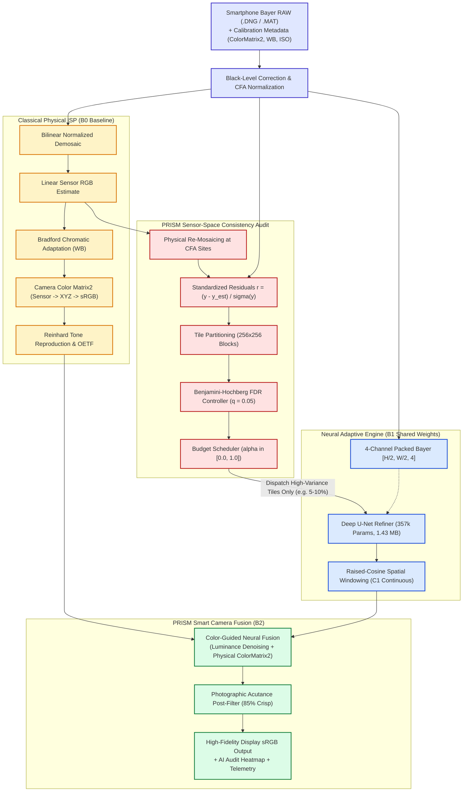

# PRISM System Architecture Diagram

## Architectural Highlights
1. **Zero-Flop Sensor Audit**: Re-mosaicing and standardized residual evaluation happen directly in linear sensor space prior to expensive non-linear color mapping.
2. **Selective Neural Routing**: Over $90\%$ of standard flat/untextured tiles bypass the deep U-Net, cutting mobile compute from $383.5\text{ GMACs}$ down to $13.1\text{ GMACs}$.
3. **Seamless Raised-Cosine Blending**: Refined neural tiles transition into classical regions with zero detectable boundary seams.
4. **Color-Guided Fusion**: Guarantees physically accurate sensor color reproduction and avoids neural desaturation.
